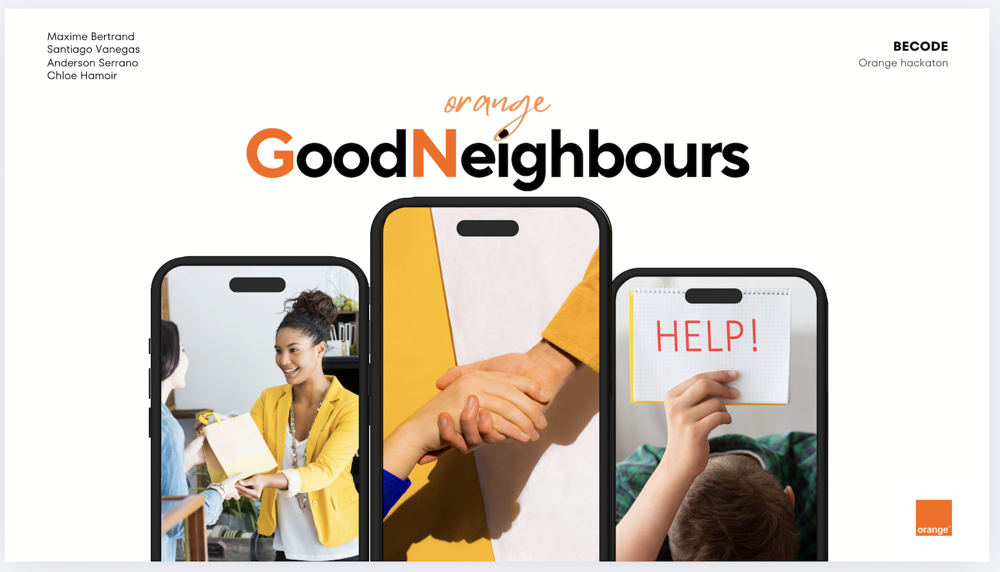

# 🟠​ Hackathon Orange : Application GoodNeighboors 🟠​

## 📌  Description

This project was developed as part of a one-week hackathon organized by Orange, in collaboration with a team of four people. The goal was to create an application using beta-test APIs provided by Orange. The project theme focused on locality, mutual aid, and spontaneity. 

--- 

## ▶️​ The Presentation

[CANVA](https://www.canva.com/design/DAGXA20tEyc/Ve0QFC0k62XC3ExfyskoEg/edit?utm_content=DAGXA20tEyc&utm_campaign=designshare&utm_medium=link2&utm_source=sharebutton)

--- 

## 🚀 Technologies Used
HTML5: For structuring the application.
SCSS: For styling and ensuring a clean visual appearance.
JavaScript: The core technology used extensively for handling and mastering the APIs.

---

## 🎯 Features 

🎨 User-friendly UI/UX : Designed for simplicity and ease of use for people of all ages
🔗 Integration of Orange APIs: Mastery of complex API calls.
👥 Team collaboration: Successfully worked as a group of four, merging ideas and skills for a societal and environmental purpose.

---

## ⚠️​ Important Notice 
It is unnecessary to test this application on a computer, as the beta-test APIs used may no longer be relevant at the time of reading this description. Consequently, some features may no longer function properly.

